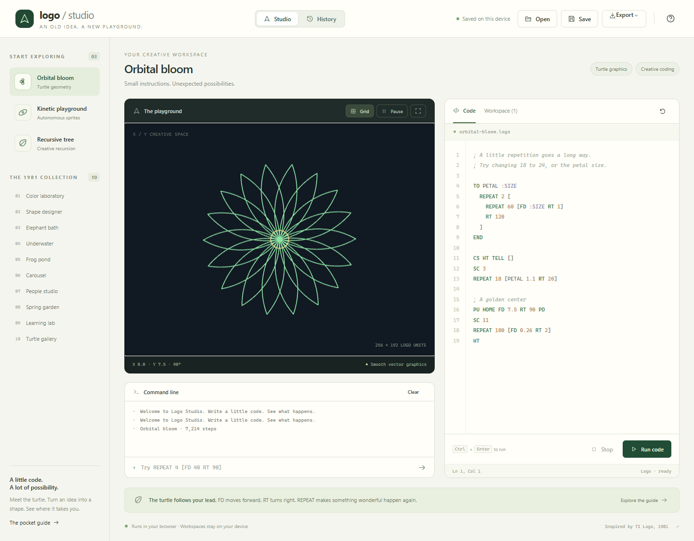
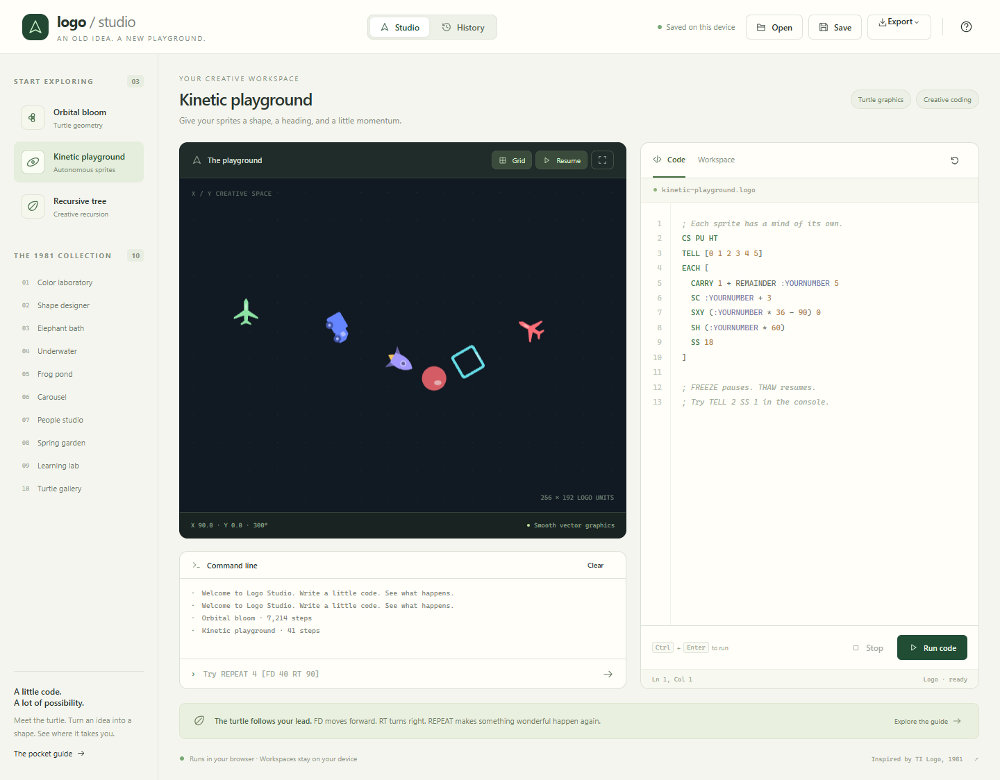
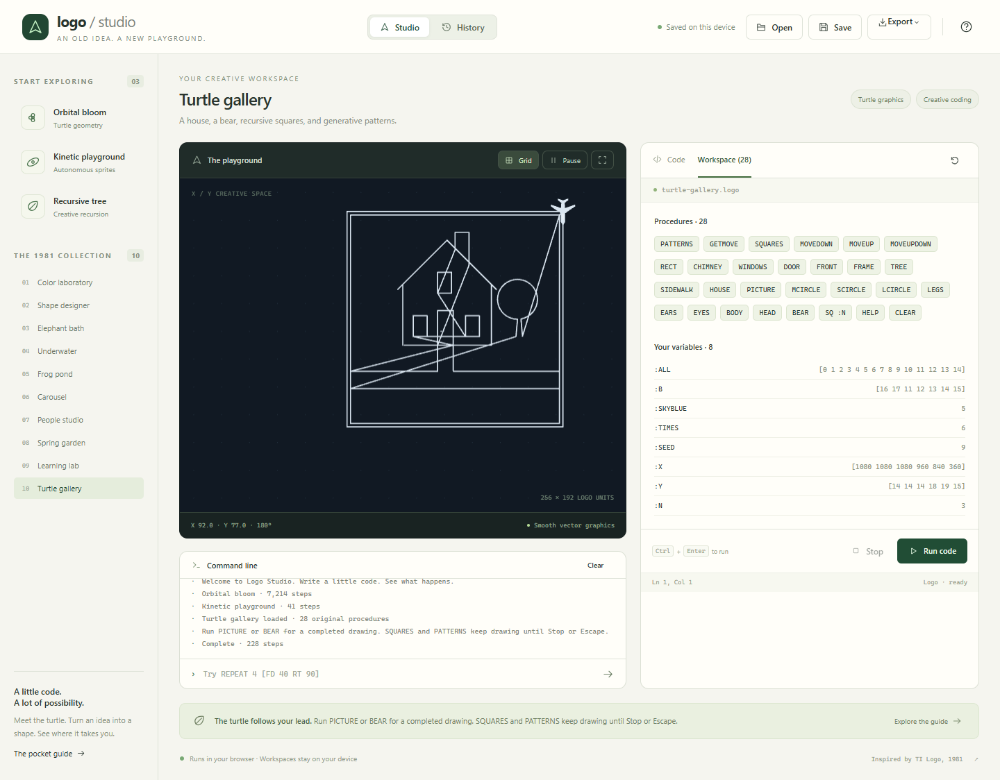
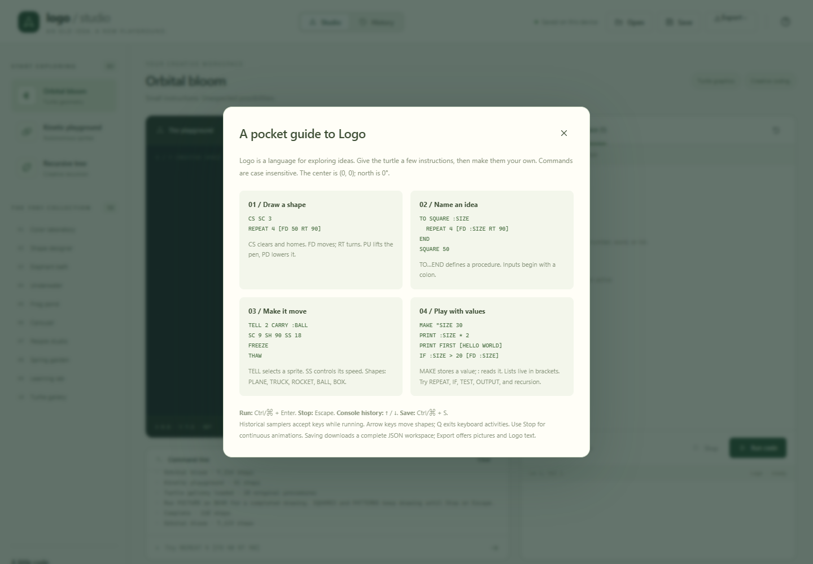
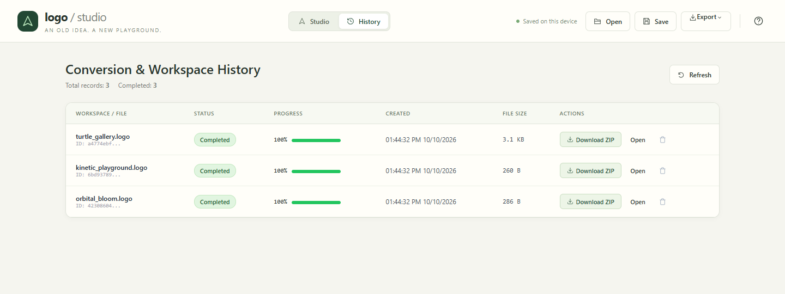
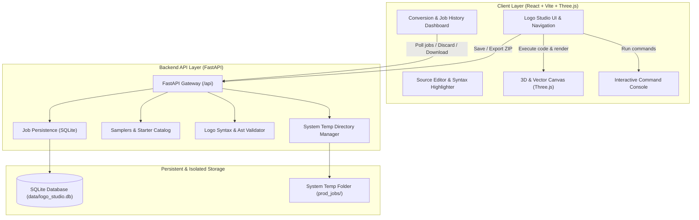

# TI Logo Studio — Full-Stack Web Application

A full-fledged, productionized web application for the TI Logo programming language featuring an authentic editable workspace, interactive console, autonomous sprites, smooth vector graphics powered by Three.js, all ten 1981 sampler programs, and an isolated Python FastAPI conversion and history pipeline.

## Screenshots

Orbital bloom with the live drawing canvas, syntax-highlighted editor, and interactive console.



Kinetic playground brings autonomous sprites to life.



The original 1981 Turtle gallery sampler, with its procedures available in Workspace.



The built-in pocket guide introduces drawing, procedures, sprites, and variables.



Workspace history shows completed example conversions and ZIP downloads using demo data.



## Architecture



---

## Features

- **Turtle Graphics & Three.js Vector Renderer**: Coordinate space of 256 × 192 units, with origin at center, north at 0°, east at 90°. Smooth antialiased strokes, vector contours, and curved silhouettes.
- **Autonomous Sprites & Tiles**: 32 autonomous sprites with headings, velocities, colors, and editable 16×16 bitmap shape patterns (`MS` command / interactive shape editor).
- **Interactive Command Console**: Real-time terminal with command line prompt (`›`), execution logs, and arrow up/down command history.
- **Complete 1981 Sampler Collection**: All ten authentic sampler workspaces (`A_COLORS`, `A_DESIGN`, `A_ELEPHANT`, `A_FISH`, `A_FROG`, `A_HORSE`, `A_PEOPLE`, `A_SPRING`, `P_EDSAMP`, `P_FUNSAMP`).
- **Starter Explorations**: `Orbital bloom`, `Kinetic playground`, and `Recursive tree`.
- **Ingestion & Clipboard**: Native file picker, drag-and-drop dropzone, and clipboard paste (`Ctrl+V`) for `.logo` and `.json` files.
- **Conversion & History Dashboard**: Persistent SQLite ledger of all conversion and execution jobs with live status badges, progress bars, **Continue**, **Discard** (purging temporary directories), and **Download ZIP**.
- **Isolated System Temp Pipeline**: Job execution stages files into `<temp>/prod_jobs/<uuid>` (`inputs/`, `work/`, `outputs/`, `archive/`) ensuring zero repository pollution.
- **Export Capabilities**: Pictures (`.png`), scalable vectors (`.svg`), readable procedures (`.logo`), editor source (`.logo`), and consolidated package bundles (`.zip`).

---

## Quick Start

### Windows

```powershell
.\setup.bat
.\run.bat
```

### Linux / macOS

```bash
chmod +x setup.sh run.sh
./setup.sh
./run.sh
```

The runner inspects port availability (defaulting to backend `8000` and frontend `5173`), negotiates free ports, sets CORS policies, and launches both services concurrently.

---

## Configuration

Copy `.env.example` to `.env` to configure ports, bind addresses, and database paths:

| Variable | Default | Purpose |
| --- | --- | --- |
| `BACKEND_PORT` | `8000` | Preferred backend port |
| `FRONTEND_PORT` | `5173` | Preferred frontend port |
| `BACKEND_HOST` | `127.0.0.1` | Backend bind host |
| `LOGO_DB_PATH` | `data/logo_studio.db` | Persistent SQLite database location |
| `PROD_TEMP_DIR` | `<tempdir>/prod_jobs` | Isolated temporary job directory root |
| `CORS_ORIGINS` | `http://localhost:5173,...` | Allowed CORS origins |

---

## API Endpoints

| Method | Path | Description |
| --- | --- | --- |
| `GET` | `/api/health` | Service health status |
| `POST` | `/api/jobs` | Stage input file/code and launch isolated conversion job |
| `POST` | `/api/jobs/direct` | Launch conversion job from direct text payload |
| `GET` | `/api/jobs` | List all historical and active jobs |
| `GET` | `/api/jobs/{id}` | Retrieve specific job details |
| `POST` | `/api/jobs/{id}/discard` | Abort active job and purge its system temporary directory |
| `DELETE` | `/api/jobs/{id}` | Delete job record and associated temporary files |
| `GET` | `/api/jobs/{id}/download-zip` | Stream consolidated output `.zip` archive |
| `GET` | `/api/samplers` | List all 10 authentic samplers with metadata |
| `GET` | `/api/samplers/{id}` | Retrieve specific sampler source and instructions |
| `POST` | `/api/logo/validate` | Syntax check and structure validation for Logo code |
| `POST` | `/api/workspace/export-zip` | Package workspace, vectors, and source into a downloadable ZIP |

Interactive OpenAPI documentation is available at `/docs`.

---

## Test Suites

```powershell
# 1. Backend Unit & Integration Tests (FastAPI, SQLite, Temp Manager)
.venv\Scripts\python.exe -m unittest discover -s backend/tests -v

# 2. Frontend Unit Tests (Core Interpreter, Graphics, Samplers, Workspaces)
cd frontend
npm test

# 3. Frontend Typecheck & Build
npm run typecheck
npm run build

# 4. Playwright End-to-End Tests (Full-Stack Live Testing)
cd ..\e2e
npm test
```

---

## Project Structure

```text
logo-programming-language/
├── backend/                   # Python FastAPI backend service
│   ├── app/
│   │   ├── main.py            # API entrypoint and routes
│   │   ├── config.py          # Settings and environment configuration
│   │   ├── schemas/           # Pydantic request/response schemas
│   │   ├── services/          # Job persistence, pipeline, and Logo services
│   │   └── utils/             # Isolated system temp directory manager
│   ├── requirements.txt       # Python dependencies
│   └── tests/                 # Backend unittest suite
├── frontend/                  # React + Vite + Three.js application
│   ├── src/
│   │   ├── components/        # Navigation, StudioScreen, HistoryScreen, Icons
│   │   ├── core/              # Interpreter, graphics, tokenizer, workspace
│   │   ├── data/              # 10 authentic samplers & starter examples
│   │   ├── rendering/         # Three.js scene, vector artwork, outlines
│   │   ├── services/          # API client
│   │   └── styles.css         # Preserved retro-computing dark atmospheric styling
│   ├── tests/                 # 40 Node unit and integration tests
│   └── package.json           # Frontend dependencies (React, Three.js, Vite)
├── e2e/                       # Playwright end-to-end integration test suite
├── screenshot/                # Application screenshots used in this README
├── data/                      # Local SQLite database directory
├── setup.py / setup.*         # Automated cross-platform environment setup
├── run.py / run.*             # Unified concurrent process orchestrator
└── secrets.md                 # Security & credentials audit report
```
